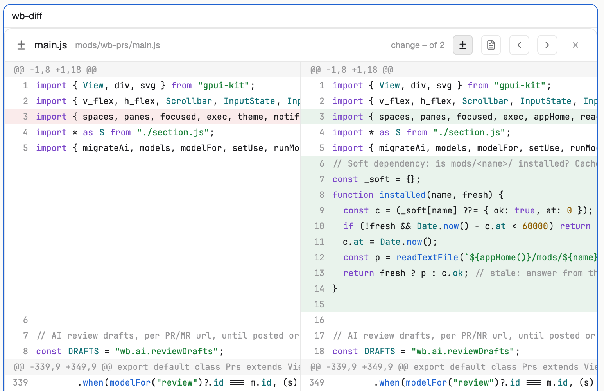

# wb-diff

A side-by-side diff viewer for the main area of a Herdr tab: old file on the left, new on the right, changed hunks highlighted, with syntax colors. It shows the working tree, a comparison against a ref, or a single commit.

## What you see

- Header: diff icon, file name and path, "change N of M", mode buttons, previous / next change buttons, a close button.
- Two code columns with line numbers and hunk headers (`@@ ... @@`). Removed lines are tinted red on the left, added lines green on the right; each side scrolls horizontally on its own, vertical scroll is shared.

## How it behaves

- Mode `diff`: hunks with 3 lines of context (`git diff`). Mode `file`: the whole file (`-U1000000`) with changes highlighted.
- Previous / next jump between changes (Alt+Up / Alt+Down while the pane has focus).
- It gets its target from its props, or from shared state `wb.diff.request`: `{ space, root, on, path, against, commit, status, fresh, ts }`. A tab only follows requests whose `space` matches its own.
- The close button closes the tab.

## Built from

- `mods/wb-diff/` with `main.js`, `highlight.js` (syntax tokens) and `icons/`.
- Runs `git diff --no-ext-diff --no-color` (plus `commit^!` or a ref) through `exec`, on the machine given by `on`.
- Opened by `wb-changes` and `wb-git` with `tab.new { mod: "wb-diff", props }`; to use it alone:
  `herdr-app do tab.new --mod wb-diff --props '{"root":"/path/to/repo","path":"file.js","status":"M"}'`.
- No keys file, no network, no tokens.

## Watch out

- Needs `git` on the machine that holds the repo.
- Not a launcher by itself: nothing opens it unless `wb-changes`, `wb-git` or your own call sends it a request.
- Very large files in `file` mode are slow.

## Done when

- `herdr-app check mods/wb-diff` passes.
- The `tab.new` command above shows a two-column diff for a changed file.
- Previous / next move through changes and the close button closes the tab.
