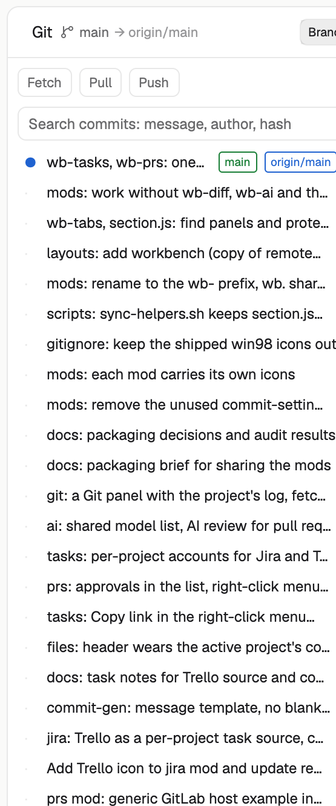

# wb-git

A Git panel for the active space's repository: the commit log with branch and tag badges, Fetch / Pull / Push, search, and a commit view with its files.

## What you see

- Header: "Git", branch chip with upstream (`main -> origin/main`), a Branch / All switch, refresh.
- Buttons Fetch, Pull, Push and a status text ("up to date", ahead and behind counts).
- A search box (message, author, hash) and the log: graph dot, subject, branch and tag badges, author, relative time. Branch mode shows the branch with its upstream (incoming and outgoing); All shows every branch.

## How it behaves

- Fetch runs `git fetch --prune`; a quiet fetch runs every 5 minutes. Pull is fast-forward; if branches diverged it rebases with autostash and aborts the rebase on conflict. Push uses `push -u origin HEAD` when there is no upstream.
- Click a commit: full message and changed files. Click a file: that commit's diff in the main area through `wb-diff`; without `wb-diff` the commit opens on GitHub / GitLab in the browser (from origin's URL), else a toast says to install `wb-diff`.
- Right-click copies the hash.
- The log is cached per repo and shows at once when you switch space.
- Works for spaces on other machines (git runs there with `exec(..., { on })`).

## Built from

- `mods/wb-git/`: `main.js`, `section.js`, `icons/`. Optional partner: `wb-diff`.
- `git` only (plus `open` for web links). No network except git's own remotes. Shared keys: `wb.diff.request`, `wb.branch.switched`, `wb.layout.*`, `wb.sections.collapsed`.
- Put it in any layout as a block `{ "content": { "mod": "wb-git" } }`, or as a child of a stack.
- `section.js` is a copy kept in sync by `scripts/sync-helpers.sh`.

## Watch out

- `exec("open")` is macOS only; elsewhere the web link does nothing.
- Needs `git`; a space without a repository shows a short message.

## Done when

- `herdr-app check mods/wb-git` passes.
- In a clean `mods/` with only `wb-git`, the panel shows the log without errors.
- Fetch, Pull and Push update the status text; clicking a commit shows its files.
