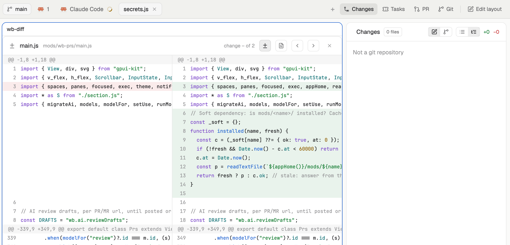

# Workbench

A whole Herdr window built around a code review loop: spaces, a Files tree and agents on the left, tabs with a branch chip on top, and a right-hand panel stack with Changes (commit and AI commit messages), Tasks (Jira or Trello), PR (GitHub and GitLab) and Git (commit log). Clicking a changed file or a commit file opens a side-by-side diff in the main area. Any block can be collapsed or moved with "Edit layout".

Credit: the Tasks and PR panels derive from https://github.com/gandriyko/herdr-app-config. That repository has no license file; this package carries the credit and makes no claim about reuse terms.

## What you see

- Root row, `titlebar: none`, `canvas` background, 1 px dividers.
- Left column `sidebar` (240 px): `brand` (46 px, `workspace-chrome`), `sidebar-lists` (Spaces `wb-spaces`, Files `wb-files`, Remote projects `wb-projects` 31 px, Agents `wb-agents` 42 px), `sidebar-footer` (69 px, `workspace-chrome` with `footer: true`).
- Right column `work`: `tabs` (`wb-tabs`, 42 px: space tabs, branch chip, panel buttons Changes / Tasks / PR / Git, Edit layout), then `work-body` with the active tab (`{ "tab": "active" }`) and the 358 px `panel` column, then `status` (`workspace-status`, 28 px).
- `panel-body` is a stack with four blocks: `changes` (`wb-changes`), `jira` (`wb-tasks`), `prs` (`wb-prs`), `git` (`wb-git`).
- Preview: a diff tab (`wb-diff`) in the main area, the Changes panel on the right.

## How it behaves

- Panel buttons in the tab bar switch the active child of the stack. They exist only for `PANELS` mods that are in that stack.
- Changes: file list or tree, click a file to open its diff in a tab (one diff tab per space); commit message box with a drag handle; Generate asks the chosen AI model.
- Git: branch or all-branch log, Fetch, Pull (fast-forward, else rebase with autostash, aborted on conflict), Push; click a commit then a file for that commit's diff.
- PR: open PRs/MRs with approvals and pipeline dot, All/Mine, right-click menu, popup with AI review draft.
- Tasks: per project (repo by origin) a Jira board by columns or a Trello board; drag a card to another column to move it.
- Agent statuses (working, blocked, done, idle) come from the cloned Herdr Agents and Spaces mods and look as in Herdr.
- Edit layout: drag a block by its title onto the half of another block; click titles to collapse.
- Branch chip opens `wb-branch-picker` as a popup. Remote projects use `wb-folder-picker`.

## Built from

- Layout `layouts/workbench.json`, `cloned_from` is Herdr's `main` 0.1.14.
- Mods, all in `mods/`: `wb-spaces`, `wb-agents`, `wb-files`, `wb-tabs`, `wb-changes` (clones of Herdr's `spaces`, `agents`, `files`, `tabs`, `changes`; their `mod.json` has `cloned_from` and they do not follow Herdr updates); `wb-tasks`, `wb-prs`, `wb-git`, `wb-diff`, `wb-ai`, `wb-projects`, `wb-folder-picker`, `wb-branch-picker`. Herdr's own `workspace-chrome`, `workspace-status`, `menu`, `new-menu` are used as shipped.
- Shared state keys, all prefixed `wb.`: `wb.layout.edit`, `wb.layout.drag`, `wb.sections.collapsed`, `wb.diff.request`, `wb.branch.switched`, `wb.folder.pick`, `wb.prs.changed`, `wb.commit.gen`, `wb.ai.models`, `wb.ai.use`, `wb.ai.reviewDrafts`, `wb.ai.localMigrated`, `wb.tasks.accounts`, `wb.tasks.sources`. Mods copy old un-prefixed keys once if the new key is empty.
- Helpers kept identical across mods by `scripts/sync-helpers.sh`: `section.js` (canonical in `wb-spaces`), `ai.js` (`wb-ai`), `secrets.js` (`wb-tasks`).
- Programs run: `git`, `gh`, `claude`, `codex`, `security`, `open`, `sh`, `rm`; network: GitHub through `gh`, GitLab REST, Jira REST and Agile, Trello API, an optional local OpenAI-compatible server.
- `wb-projects` reads and writes `remote-projects.json` in the Herdr home; it is machine-local and not part of the package.
- Herdr commands used: `layout.set`, `layout.hide/show`, `layout.select`, `tab.new/select/rename/close`, `space.select`.

## Watch out

- Tokens (Jira, Trello, GitLab) are stored in the macOS Keychain only, through `security`. On other systems the token forms show an explanation instead. A token appears briefly in `security`'s argument list while it is saved.
- Opening links uses `exec("open")`, which is macOS only.
- Soft dependencies: without `wb-diff`, Changes shows a toast and Git opens the commit on the web; without `wb-ai`, the "AI models" item is hidden and Claude CLI is the default; without `wb-branch-picker` the branch chip is not clickable.
- `wb-tabs` finds the panel stack as the stack that holds `PANELS` blocks, and `section.js` finds protected containers from the layout tree, so ids need not match, but the layout needs at least one `wb-*` panel block.
- The clones are copies of Herdr 0.1.14 mods and will not pick up later Herdr changes.
- AI commit messages and reviews send diffs to the configured model (Claude CLI, Codex CLI or a local server).

## Done when

- `herdr-app check mods/<name>` passes for every `wb-*` mod and `herdr-app status` shows `errors: []`.
- `herdr-app do layout.switch --name workbench` shows the sidebar, tab bar, panel stack and status bar.
- The tab-bar buttons switch between Changes, Tasks, PR and Git.
- Clicking a file in Changes opens a diff tab; Edit layout moves and collapses blocks.
- With `wb-diff`, `wb-ai` or `wb-branch-picker` removed, the other mods still render without errors.
